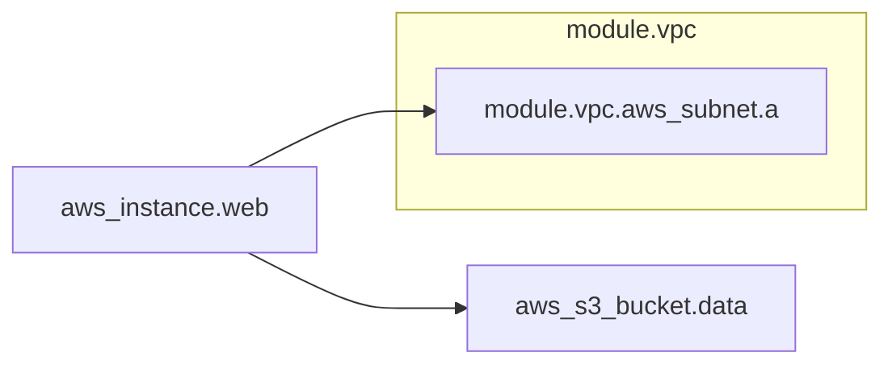

# tf-graph-md

[](https://github.com/moveeeax/tf-graph-md/actions/workflows/ci.yml)
[](https://www.python.org/)
[](LICENSE)

> Turn your Terraform dependency graph into a Mermaid diagram you can paste into any README.

`terraform graph` emits Graphviz DOT — which you can't view without Graphviz, and
which nobody wants to render to a PNG and commit. `tf-graph-md` converts that DOT
into a **Mermaid** `graph`, which GitHub renders inline. Pipe it to a file, or inject
it straight into a README between markers. It's a pure local transform — no Graphviz,
no external services.



## What it does

- Parses the DOT that `terraform graph` produces into nodes and edges.
- Emits valid Mermaid `graph` syntax that renders on GitHub.
- Collapses provider/meta plumbing nodes by default (`--no-collapse` to keep them).
- Groups resources into `subgraph`s by module with `--group-modules`.
- Injects the diagram into a README between markers, **idempotently**.

## Install

```bash
pip install tf-graph-md
```

## Usage

```bash
# render to a Mermaid file
terraform graph | tf-graph-md --group-modules > graph.mmd

# inject into a README between the markers (safe to re-run)
terraform graph | tf-graph-md --inject README.md
```

Injection replaces whatever is between these two markers (adding them at the end if
they're absent):

```
<!-- tf-graph-md:start -->
<!-- tf-graph-md:end -->
```

| Flag | Description |
|------|-------------|
| `-i`, `--input` | Read DOT from a file instead of stdin |
| `-d`, `--direction` | Mermaid direction: `LR` (default), `RL`, `TD`, `TB`, `BT` |
| `--group-modules` | Group nodes into `subgraph`s by module |
| `--no-collapse` | Keep provider/meta plumbing nodes |
| `--inject README` | Write the diagram into a README between markers |

## How it works

Node ids are normalized — the `[root]` prefix and Terraform's graph-mode suffix
(` (expand)`, ` (close)`) are stripped so edge endpoints and node declarations agree
on a clean resource address. Provider and meta nodes are filtered, module prefixes
drive the `subgraph` grouping, and stable `n0`, `n1`… ids keep labels (which contain
dots and brackets) out of Mermaid's identifier grammar. Everything runs on the DOT
text alone, so the parser and renderer are unit-tested against fixtures with no
Terraform or Graphviz installed.

## Development

```bash
make install   # pip install -e ".[dev]"
make test      # pytest -q
```

## License

MIT — see [LICENSE](LICENSE).
